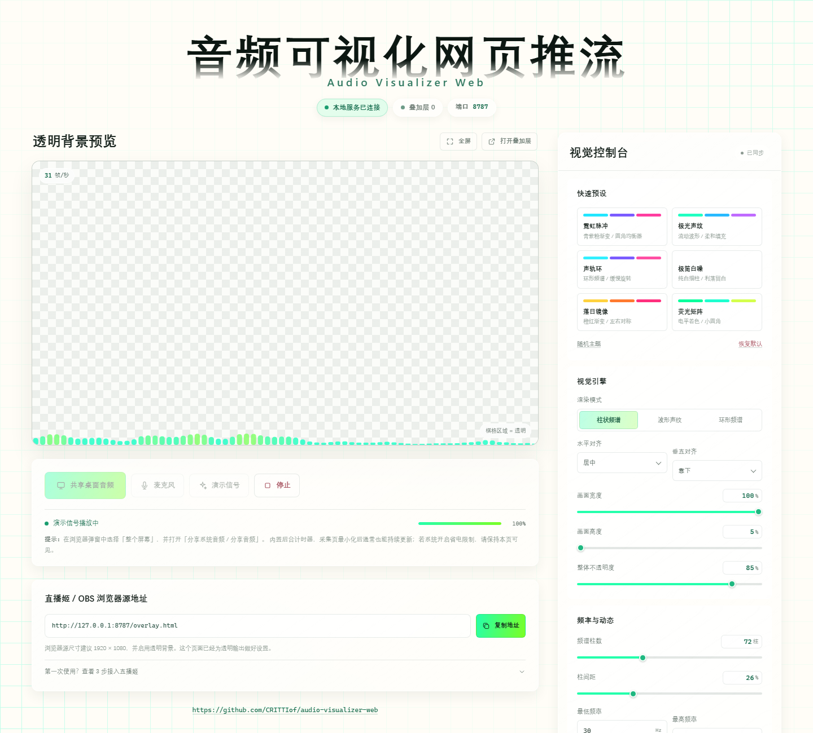
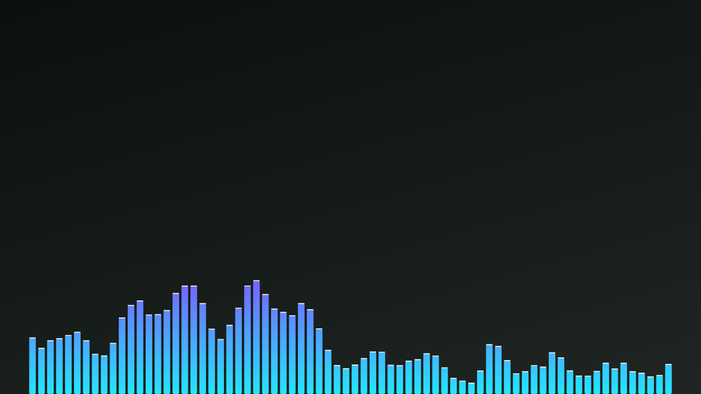

# 音频可视化网页推流-Audio Visualizer Web

本地运行的桌面音频频谱可视化工具，为 **哔哩哔哩直播姬 / OBS 浏览器源** 提供透明叠加层。Chrome / Edge 控制台负责采集与分析，Node 本地服务只在本机回传频谱数据，音频不会上传。

- **透明输出**：叠加层默认不绘制背景，可直接作为浏览器源使用。
- **实时频谱**：柱状频谱、波形声纹、环形频谱三种模式。
- **高度可调**：颜色、频率范围、柱数、间距、圆角、镜像、平滑、峰值、布局等均可实时调整并自动保存。
- **端口可改**：支持 `config.json`、命令行参数和环境变量。
- **零依赖**：只需要 Node.js 18+，无需安装 npm 包。

仓库：<https://github.com/CRITTIof/audio-visualizer-web> · 维护者：**Rei Xinglan（CRITTIof）** · <crittiof@outlook.com>

> 标题、副标题、字体、字号、颜色、透明度以及背景方格样式集中在 `public/ui-theme.json`，修改方法见 [标题与界面外观配置说明](docs/ui-theme.md)。





## 快速开始

要求：Node.js 18+，最新版 Chrome 或 Edge。

```bash
git clone https://github.com/CRITTIof/audio-visualizer-web.git
cd audio-visualizer-web
node server.js
```

Windows 也可以双击 `start.bat`；macOS / Linux 可执行 `bash start.sh`。

启动后：

- 控制台：`http://127.0.0.1:8787/`
- 透明叠加层：`http://127.0.0.1:8787/overlay.html`

### 采集桌面音频

1. 用 Chrome / Edge 打开控制台。
2. 点击「共享桌面音频」。
3. 在浏览器弹窗中选择 **整个屏幕**，打开 **分享系统音频 / 分享音频**。
4. 保持控制台页面打开，叠加层会实时接收频谱数据。

采集循环由 Web Worker 时钟驱动，控制台最小化后通常仍能以约每秒 30 帧更新。若系统开启强省电模式，可使用 `open-capture.bat` 打开已关闭后台节流的专用窗口。

### 添加到直播姬 / OBS

1. 添加「浏览器」源。
2. URL 填 `http://127.0.0.1:8787/overlay.html`。
3. 尺寸建议 `1920 × 1080`。
4. 开启透明背景，并把浏览器源放在场景上层。

没有音频时，可在控制台点击「演示信号」，或打开 `http://127.0.0.1:8787/overlay.html?demo=1` 预览效果。

## 修改端口

任选一种方式，修改后重启服务：

```bash
# 方式一：编辑 config.json 里的 port
# 方式二：命令行参数
node server.js --port 9000

# 方式三：环境变量
PORT=9000 node server.js
```

优先级：命令行 `--port` > 环境变量 `PORT` > `config.json` > 默认 `8787`。Windows 启动脚本也支持 `start.bat --port 9000`。

## 自定义

所有频谱与渲染参数会 **自动保存到 `config.json`**，并通过本地服务同步到叠加层。频率范围、灵敏度、噪声门限、镜像、峰值等都可以在控制台直接调整。

页面标题、副标题、字体、字号、颜色、透明度，以及背景底色和方格样式，写在 `public/ui-theme.json`。修改后刷新页面即可生效，完整字段说明和示例见 **[docs/ui-theme.md](docs/ui-theme.md)**。

## 工作原理

```text
Chrome / Edge 控制台
  桌面音频 → Web Audio AnalyserNode → 192 段频谱 + 波形
        ↓ POST /api/frame（本机回环）
Node 本地服务（HTTP + SSE）
        ↓ SSE
直播姬 / OBS 浏览器源 → Canvas 透明渲染
```

服务默认只监听 `127.0.0.1`，不依赖云服务或第三方 npm 包。

## 常见问题

- **没有声音**：重新采集，确认选择「整个屏幕」并勾选分享系统音频；也可以先试「麦克风」。
- **叠加层黑底 / 白底**：确认地址是 `/overlay.html`，浏览器源已开启透明背景，控制台背景不透明度为 0。
- **一直显示等待音频**：确认控制台仍在采集，并检查页面上的「本地服务已连接」状态和端口是否一致。
- **帧率很低**：让采集页保持可见，或使用 `open-capture.bat`；必要时在浏览器性能设置中排除 `127.0.0.1`。
- **端口被占用**：换一个端口，例如 `node server.js --port 8788`。

## 文件结构

```text
├─ server.js            # 本地 HTTP + SSE 服务
├─ config.json          # 端口与频谱参数
├─ public/
│  ├─ index.html        # 控制台 / 采集端
│  ├─ overlay.html      # 透明叠加层
│  ├─ ui-theme.json     # 标题与页面外观
│  ├─ theme.js          # 读取 ui-theme.json
│  ├─ visualizer.js     # Canvas 渲染器
│  ├─ app.js            # 采集与配置逻辑
│  └─ settings.js       # 设置 schema、校验、预设
├─ start.bat / start.sh
├─ open-capture.bat     # 关闭后台节流的采集窗口
└─ docs/                # 文档与预览图
```
